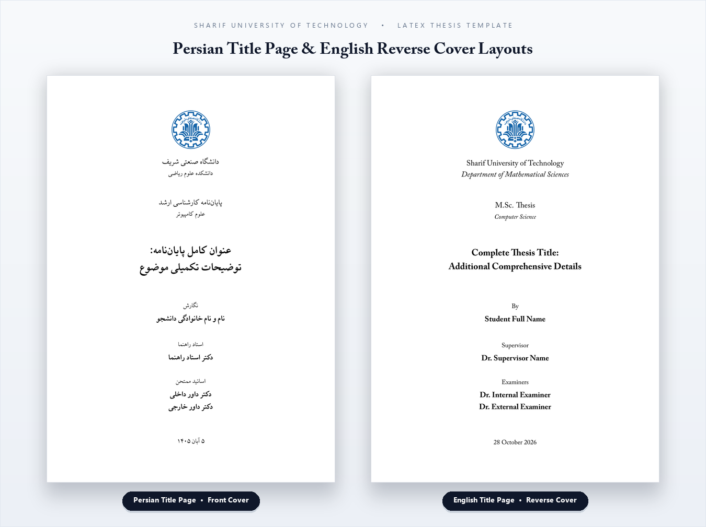

<div align="center">

# Modern Persian LaTeX Thesis Template
*Sharif University of Technology (SUT)*

<p align="center">
  <a href="https://tug.org/xetex/"></a>
  <a href="https://ctan.org/pkg/xepersian"></a>
  
  <a href="https://www.python.org/"></a>
  <a href="https://creativecommons.org/licenses/by/4.0/"></a>
</p>

<p align="center">
  A modernized, highly robust, and architecturally decoupled LaTeX template engineered for typesetting Master's theses, Ph.D. dissertations, and Bachelor's projects in Persian and English, fully conforming to the formatting guidelines of <strong>Sharif University of Technology (SUT)</strong>.
</p>

<p align="center">
  
</p>

</div>

---

## 📖 Table of Contents

- [Overview](#-overview)
- [Start Compiling](#-start-compiling)
  - [Option A: Online Compilers (Overleaf & Sharif LaTeX)](#option-a-online-compilers-overleaf--sharif-latex)
  - [Option B: VS Code (LaTeX Workshop)](#option-b-vs-code-latex-workshop)
  - [Option C: Command Line (latexmk)](#option-c-command-line-latexmk)
- [Repository Architecture](#-repository-architecture)
- [Original vs. Upgraded Template](#%EF%B8%8F-original-vs-upgraded-template)
  - [Comparison Table](#comparison-table)
  - [Breakdown of Smaller Upgrades](#breakdown-of-smaller-upgrades)
- [Key Features](#%EF%B8%8F-key-features)
  - [1. Decoupled Core Engine vs. User Layer](#1-decoupled-core-engine-vs-user-layer)
  - [2. Elastic-Spaced Title Pages & Committee Architecture](#2-elastic-spaced-title-pages--committee-architecture)
  - [3. Automated Bidirectional Glossary Pipeline](#3-automated-bidirectional-glossary-pipeline)
  - [4. Automated Administrative Forms & Standalone PDF Exporter](#4-automated-administrative-forms--standalone-pdf-exporter)
  - [5. Scanned Signed Forms Integration](#5-scanned-signed-forms-integration)
  - [6. Structured & Hyperlinked Bibliography](#6-structured--hyperlinked-bibliography)
  - [7. Multilingual Typography & Font Integration](#7-multilingual-typography--font-integration)
  - [8. Custom Visual Elements: Grayscale Academic Boxes](#8-custom-visual-elements-grayscale-academic-boxes)
  - [9. Zero-Warning Diagnostics & ChkTeX Cleanliness](#9-zero-warning-diagnostics--chktex-cleanliness)
- [Customization Guide](#%EF%B8%8F-customization-guide)
  - [Setting Thesis Metadata (`frontmatter/info.tex`)](#setting-thesis-metadata-frontmatterinfotex)
  - [User Overrides (`styles/custom.tex`)](#user-overrides-stylescustomtex)
  - [Writing Chapter Content](#writing-chapter-content)
  - [Vector Figures & TikZ Diagrams](#vector-figures--tikz-diagrams)
- [Comprehensive Technical Appendices](#-comprehensive-technical-appendices)
- [Frequently Asked Questions (FAQ)](#-frequently-asked-questions-faq)
- [Credits](#-credits)
- [License](#-license)

---

## 💡 Overview

Academic typesetting in Persian has historically presented significant friction for graduate researchers. Common pitfalls include fragile styling, cryptic errors, font issues in title numbering, hyperref anchor collisions, unformatted bidirectional inline code snippets, and manual, error-prone compilation of English-Persian glossaries.

This repository represents a **ground-up modernization and architectural re-engineering** of the classic Sharif thesis template. It preserves the clean layout traditions established by early designers while introducing modern software engineering principles: strict separation of concerns, single sources of truth, automated Python collation pipelines, PDF 1.7 vector rendering, and zero-warning compilation diagnostics.

### 🇮🇷 درباره و معرفی قالب (به زبان فارسی)

این مخزن شامل **نسخه بازطراحی‌شده و مدرن قالب پایان‌نامه لاتک دانشگاه صنعتی شریف** است. این قالب بر مبنای استانداردهای آموزشی دانشگاه صنعتی شریف برای تدوین **رساله دکتری**، **پایان‌نامه کارشناسی ارشد** و **پروژه کارشناسی** در تمامی رشته‌ها آماده‌سازی شده است. ساختار این قالب با جداسازی کامل موتور استایل و قلم‌ها از محتوای کاربر، برطرف‌سازی خطاهای رایج زی‌پرشین، اتوماتیک‌سازی جزئیات شرطی صفحات عنوان و فرم‌ها، همراه با پایپ‌لاین خودکار برای ساخت و به‌روزرسانی واژه‌نامه‌های دوطرفه (فارسی به انگلیسی و انگلیسی به فارسی)، و سازگاری کامل با کامپایلرهای آنلاین (مانند [Overleaf](https://www.overleaf.com/) و سامانه [لاتک شریف](https://latex.sharif.ir/)) در کنار ویرایشگر VS Code و خط فرمان لاتک (`latexmk`)، تجربه‌ای استاندارد، روان و بدون اخطار (Zero-Warning) را برای پژوهشگران فراهم می‌کند (تنها با تنظیم موتور کامپایلر روی XeLaTeX).

> [!NOTE]
> **Built-in Dual-Purpose Writing & Technical Guide:**
> The sample body text across [chapters/](/chapters) (Chapters 1 through 6) is not arbitrary dummy text. It is deliberately authored to serve simultaneously as:
> 1. **An academic thesis writing guide:** Describing best practices for formulating the problem statement, preliminaries, literature review, methodology, empirical evaluation, and conclusions.
> 2. **A live technical reference for the template:** Demonstrating real-world usage of mathematical equations, theorem environments, algorithmic pseudocode, data tables, modular TikZ vector diagrams, bilingual inline code formatting, and BibTeX citation rules.
> 
> Furthermore, the repository includes three comprehensive standalone guides in [appendices/](/appendices) that document every architectural component in depth.

---

## 🚀 Start Compiling

This template is engineered to compile seamlessly across both **online cloud compilers** and **local desktop environments**. The only universal requirement is choosing **XeLaTeX** as the compiler engine (strictly required by `xepersian` for bidirectional TrueType/OpenType font loading).

You can clone the repository through the "Use this template" button or download the `.zip` from "Releases" or "Code > Download ZIP". After downloading, proceed with one of the options below:

### Option A: Online Compilers (Overleaf & Sharif LaTeX)

The template has been thoroughly verified on leading online LaTeX platforms, compiling cleanly with **zero errors**. Furthermore, the automated bidirectional dictionary and technical glossary compile and update properly without manual sorting.

- **[Overleaf](https://www.overleaf.com/):**
  1. Click **New Project** → **Upload Project** and select the template `.zip` file.
  2. Open the project, click the **Menu** button (top-left corner), and change **Compiler** to **XeLaTeX**.
  3. Ensure the **Main document** is set to `thesis.tex`.
  4. Click **Recompile**.
- **[Sharif LaTeX](https://latex.sharif.ir/):**
  1. Log in to [Sharif LaTeX](https://latex.sharif.ir/) (سامانه نگارش آنلاین مقالات و پایان‌نامه‌های دانشگاه صنعتی شریف).
  2. Create a new project by uploading the template `.zip` file.
  3. In project settings, ensure the compiler engine is set to **XeLaTeX** and the main document is `thesis.tex`.
  4. Click **Recompile**.

> [!TIP]
> Overleaf and Sharif provide built-in `latexmk` and Python execution, meaning `scripts/build_dictionaries.py` automatically runs whenever `backmatter/words.tex` is edited and saved. Pre-compiled fallback dictionary files are also bundled in `backmatter/` to ensure instant, zero-friction compilation.

### Option B: VS Code (LaTeX Workshop)

1. Install Visual Studio Code and the official **LaTeX Workshop** extension.
2. Open this repository folder in VS Code.
3. Open `thesis.tex` and trigger the build recipe: `latexmk (xelatex)`.
   - Alternatively, press `Ctrl+Alt+B` (Windows/Linux) or `Cmd+Option+B` (macOS).
4. The bundled `.vscode/settings.json` is pre-configured with:
   - Automated XeLaTeX compilation recipe.
   - Pinned root document (`thesis.tex`).
   - Custom `chktex` linting flags tailored for the document.

### Option C: Command Line (`latexmk`)

Run the pre-configured `latexmk` pipeline:

```bash
latexmk -xelatex -synctex=1 -interaction=nonstopmode thesis.tex
```

To clean compilation auxiliary files:

```bash
latexmk -c thesis.tex   # Cleans auxiliary files (.aux, .log, .fls, .out, etc.)
latexmk -C thesis.tex   # Cleans auxiliary files and the compiled thesis.pdf
```

---

## 📂 Repository Architecture

The repository enforces strict separation between internal style engines, user customization, document sections, bibliography, and build automation:

```
├── thesis.tex                          # Master document entry point & document flow
├── thesis.pdf                          # Compiled thesis sample PDF
├── LICENSE                             # Creative Commons Attribution 4.0 International License
├── latexmkrc                           # Build automation & Python dictionary compiler hook
├── .gitignore                          # Production-grade git ignore rules
├── .gitattributes                      # Binary file attributes for Git
├── .vscode/
│   └── settings.json                   # Pre-configured VS Code LaTeX Workshop build & lint settings
├── frontmatter/                        # Front matter & administrative pages
│   ├── info.tex                        # [CENTRAL METADATA] Title, author, supervisor, advisors, examiners
│   ├── title.tex                       # Persian title page (elastic spring layout)
│   ├── besmellah.tex                   # Dedication page ("In the Name of God")
│   ├── signatures.tex                  # Committee Approval form (صفحه تصویب‌نامه)
│   ├── declaration.tex                 # Academic Integrity Declaration (صفحه اظهارنامه)
│   ├── acknowledgments.tex             # Acknowledgments page (صفحه سپاس و قدردانی)
│   ├── abstract.tex                    # Persian abstract & keywords
│   └── images/
│       ├── logo.pdf                    # Official Sharif University vector logo
│       ├── besmellah.ai                # High-res vector artwork for Besmellah (Adobe Illustrator source)
│       └── besmellah.png               # High-res transparent calligraphy graphic for Besmellah
├── styles/                             # Core typography & user customization
│   ├── common.tex                      # [CORE ENGINE] Layout, fonts, packages, environments
│   ├── custom.tex                      # [USER LAYER] Personal macros, math operators, boxes, spacing overrides
│   └── fonts/                          # Bundled TrueType font families
│       ├── XB Niloofar*.ttf            # Persian text and numerals (Regular, Bold, Italic, Bold Italic)
│       ├── Sharif1.3-*.ttf             # Alternative official Sharif University font
│       └── Adobe Caslon Pro*.ttf       # Latin text typography (Regular, Bold, Italic, Bold Italic)
├── chapters/                           # Main body research chapters & live template guides
│   ├── chapter1_introduction.tex       # Chapter 1: Introduction, Problem Statement, Contributions
│   ├── chapter2_preliminaries.tex      # Chapter 2: Theoretical Foundations & Preliminaries
│   ├── chapter3_literature.tex         # Chapter 3: Comprehensive Literature Review
│   ├── chapter4_methodology.tex        # Chapter 4: Proposed Methodology & Architecture
│   ├── chapter5_experiments.tex        # Chapter 5: Empirical Setup, Benchmarks, & Results
│   └── chapter6_conclusions.tex        # Chapter 6: Discussion, Conclusions, & Future Horizons
├── appendices/                         # Supplementary material & architectural documentation guides
│   ├── appendix.tex                    # Master appendix container
│   ├── appendix_title_and_forms.tex    # Detailed guide on metadata, forms, and PDF export
│   ├── appendix_dictionary_and_glossary.tex # Detailed guide on the automated dictionary engine
│   └── appendix_bibliography_rules.tex # Detailed guide on BibTeX entries, DOI hyperlinks & rules
├── bibliography/                       # References database & custom BibTeX style
│   ├── bibliography.tex                # Bibliography loader, compact spacing & geometry
│   ├── refs.bib                        # Primary citation database (with DOIs and URLs)
│   └── unsrtabbrv-modern.bst           # Modernized BibTeX style with automatic DOI/URL hyperlinks
├── backmatter/                         # Back matter, glossaries & English pages
│   ├── words.tex                       # [SINGLE SOURCE OF TRUTH] Bidirectional vocabulary list
│   ├── dictionary_fa2en.tex            # Persian-to-English dictionary display wrapper
│   ├── dictionary_en2fa.tex            # English-to-Persian dictionary display wrapper
│   ├── dict_fa2en_content.tex          # Auto-generated, Persian-alphabet sorted glossary
│   ├── dict_en2fa_content.tex          # Auto-generated, English-alphabet sorted glossary
│   ├── abstract_en.tex                 # English abstract & keywords
│   └── title_en.tex                    # English title page (Reverse Cover)
├── figures/                            # Vector graphics, diagrams & showcase preview assets
│   ├── preview_title_pages.png         # High-resolution showcase banner of Persian & English covers
│   ├── fig_pipeline.tex                # Sample TikZ diagram
│   ├── fig_architecture.tex            # Sample TikZ diagram for PDF export
│   └── fig_architecture.pdf            # PDF export of the sample TikZ diagram
└── scripts/                            # Automation pipelines
    ├── build_dictionaries.py           # Automated Unicode Persian/English dictionary compiler
    ├── export_front_pages.py           # Standalone single-page PDF generator (signatures, declaration)
    └── export_front_pages.ps1          # PowerShell wrapper for front pages exporter
```

---

## ⚖️ Original vs. Upgraded Template

This project builds directly upon the widely adopted Persian LaTeX Thesis Template created by **Hamid Zarrabi-Zadeh** (`zarrabi/thesis-template`). The table below outlines the structural, typographic, and automated differences between the original template and this upgraded edition.

### Comparison Table

| Feature / Dimension | Original Template (`zarrabi/thesis-template`) | Upgraded Modern Template (This Repository) |
| :--- | :--- | :--- |
| **Architectural Separation** | Monolithic structure; styles, macros, and configuration mingled in `styles/common.tex`. | Strict 2-tier separation: immutable core engine (`styles/common.tex`) vs. user code (`styles/custom.tex`). |
| **Directory Organization** | Flat legacy directories (`bibs`, `figs`, `front`, `styles`, `chapters`). | Semantic academic hierarchy (`frontmatter`, `backmatter`, `bibliography`, `chapters`, `appendices`, `styles`, `scripts`). |
| **Glossary / Technical Dictionary** | Static, Persian-to-English only; manually typed and grouped in `front/dictionary.tex`. | **Automated Bidirectional System** (`words.tex`): Python compiles both `fa2en` and `en2fa` with 32-letter Persian Unicode collation. |
| **Build Automation** | Standard manual TeX compilation commands. | **`latexmkrc` Automation**: Pre-compilation hooks trigger Python dictionary builds; targets PDF 1.7 vector standard. |
| **Platform Compatibility** | Fragile; prone to errors on local environments due to deprecated packages or Persian commands. | **Universal Compatibility**: Verified with 0 errors across online compilers ([Overleaf](https://www.overleaf.com/), [Sharif LaTeX](https://latex.sharif.ir/)), VS Code, and terminal CLI; dictionaries update automatically. |
| **Administrative Forms** | Static LaTeX stubs; hardcoded committee fields; missing header titles. | **Dynamic Forms**: Auto-populated from metadata, conditional advisor/examiner logic, dedicated signing titles/dates. |
| **Form Printing / Export** | Required compiling the whole thesis to print individual administrative forms. | **Standalone Exporter (`scripts/export_front_pages.py`)**: One-command single-page PDF generation for signatures & declaration. |
| **Signed Forms Integration** | Manual manipulation of pages; prone to margins and geometry distortion. | **Zero-Margin Scanned PDF Inclusion (`\includepdfpages`)**: Native TikZ overlay engine without `pdfpages` XePersian bugs. |
| **Latin Typography** | Default fallback / Times New Roman; no dedicated Latin font family. | Full **Adobe Caslon Pro** font family (Regular, Bold, Italic, Bold Italic) integrated seamlessly with XB Niloofar. |
| **Section & Figure Numbering** | Raw hyphen separator (`\SepMark{-}`); causes cramped numbers and font-break glyph bugs. | **Balanced En-Dash Separator (`\SepMark{\,-\,}`)**: Symmetrically spaced with thin non-breaking math spaces. |
| **Non-Breaking RTL Links (`\ref` & `\nameref`)** | Unprotected; when a reference number or title wraps across lines in RTL, `xdvipdfmx` glitches, turning the whole line into a blue clickable link. | **Automatic Non-Breaking Wrappers**: Globally guards both `\ref` and `\nameref` in `\mbox`, ensuring links and blue coloring stay strictly on the referenced words without whole-line bleeding. |
| **Footnotes Layout** | Standard single-column footnotes with excessive vertical whitespace. | **Two-Column Footnotes (`\twocolumnfootnotes`)** with optimized vertical clearance (`\skip\footins=1cm`). |
| **Bibliography Hyperlinks** | Plain text citations; standard `unsrtabbrv.bst`. | **Interactive BibTeX Engine (`unsrtabbrv-modern.bst`)**: Auto-resolves `doi`, `url`, and `eprint` into clickable paper title hyperlinks. |
| **Bibliography Formatting** | Loose spacing; cluttered with editors, publisher addresses, and 50+ author lists. | **Compact Academic Styling**: Compact line spacing; truncated author lists (>10 to 6 + *et al.*); noise fields suppressed. |
| **Callout & Highlight Boxes** | Not available. | **Academic Callout Box (`\academicbox`)**: Grayscale `tcolorbox` with breakable skins and drop-caps header. |
| **Inline Code & Math in RTL** | Standard `\texttt` or `\verb`; slashes, dashes, and brackets get inverted by RTL engine. | **Safe Inline Code Macro (`\code{...}`)**: Enforces LTR wrapping (`\lr{\texttt{...}}`) inside RTL paragraphs. |
| **Numbering Box Alignment** | LoF and LoT numbers cramped; multi-digit Persian numerals collide with caption titles. | Number box widths expanded to `3.2em` (`\l@figure`, `\l@table`) and dotted leader alignment refined. |
| **Dedication Artwork** | 39 KB raster JPEG with visible compression artifacts. | **Vector Artwork**: Redrawn in Adobe Illustrator (`besmellah.ai`) + crisp 98 KB transparent PNG (`besmellah.png`). |
| **TeX Command Cleanliness** | Relies on deprecated TeX switches (`\bf`, `\tt`, `\it`, `\rm`) and obsolete packages. | **100% Modern LaTeX NFSS** (`\bfseries`, `\texttt`, `\textit`); passes strict `chktex` with **0 warnings**. |
| **Compilation Diagnostics** | Throws `xdvipdfmx` PDF minor version warnings and duplicate hyperref pageanchor errors. | **Zero Warnings**: PDF 1.7 targeted, `pageanchor=false` on unnumbered frontmatter, NFSS font substitution silenced. |
| **Sample Body Content** | Brief placeholder stubs with Persian XePersian command aliases that break on most compilers (`\فصل`, `\قسمت`). | **6 Full Academic Research Chapters** demonstrating math, theorem proofs, algorithms, tables, TikZ, and citations usage as a guide that also compiles without issue. |

---

### Breakdown of Smaller Upgrades

#### 1. Modernized TeX Syntax & Deprecated Package Cleanup
- **Removal of Shadowing Packages:** The original template shipped local copies of `algorithm.sty`, `algorithmic.sty`, `algorithmicx.sty`, and `algpseudocode.sty` in `styles/packages/`. These files shadowed modern CTAN distributions, broke TeX Live updates, and lacked modern XePersian RTL algorithmic fixes (`algorithm-xetex-xepersian.def`). All obsolete local style files were purged in favor of official TeX Live / MiKTeX packages.
- **Migration to Modern NFSS:** Eliminated all occurrences of archaic TeX font switches (`\bf`, `\tt`, `\it`, `\rm`) across all template files, replacing them with standard LaTeX New Font Selection Scheme commands (`\bfseries`, `\texttt`, `\textit`, `\textrm`).
- **Standardized Commands:** Replaced non-standard Persian command aliases (such as `\فصل`, `\قسمت`, `\شروع{فقرات}`) with standard LaTeX environments (`\chapter`, `\section`, `\begin{itemize}`), making the code compatible with standard syntax highlighters, linters, and snippet engines.

#### 2. Advanced Section, Figure & Table Numbering Aesthetics and List Spacing
- In XePersian, configuring `\SepMark{-}` produces an ASCII hyphen between chapter and section numbers. In Persian fonts, this hyphen frequently collides with numerals or renders at irregular baselines.
- The upgraded template introduces `\SepMark{\,-\,}`, placing an en-dash flanked by thin non-breaking math spaces between numbering levels. This produces elegant, beautifully balanced headings (e.g., `فصل ۱ – بخش ۲ – زیربخش ۳`) across all chapters, figures, tables, and equations.
- In addition, the spacing and number box widths across the Table of Contents, List of Figures (LoF), and List of Tables (LoT) were all expanded and adjusted (`\renewcommand*\l@figure{\@dottedtocline{1}{1.5em}{3.2em}}` and `\renewcommand*\l@table{\@dottedtocline{1}{1.5em}{3.2em}}`). This accommodates multi-digit Persian numerals without overlapping caption text, alongside standardizing formal academic list titles (**`فهرست جدول‌ها`** and **`فهرست شکل‌ها`**).

#### 3. Abstract & Frontmatter Typography
- **English Abstract Small-Caps Styling:** The English abstract title simulates balanced small-caps via `{\Large\textbf{A\scalebox{0.7}{BSTRACT}}}` paired with a tuned line-height ratio (`\thesisabstractenstretch{0.73}`), achieving professional journal-grade aesthetics.
- **Persian Abstract Header:** Formal centered header `{\Large\textbf{چکیده}}` with parameterized spacing glues (`\thesisabstractbeforespace`).
- **Keyword Formatting:** Unified macro with bold headers, italicized keyword bodies (`\textit{#1}`), and `\nopagebreak` protection preventing awkward page breaks between abstract text and keywords.

#### 4. Non-Breaking RTL Hyperlink Architecture (`\ref` & `\nameref`)
- **The Issue in the Original Template:** In XeLaTeX and XePersian using `xdvipdfmx`, when an RTL hyperlink splits across a line break, the driver's Left-to-Right bounding box calculations fail. This causes the clickable area to span from margin to margin and bleeds the blue link color across both entire lines. The original template provided no defense against this, resulting in whole lines turning blue whenever a reference number or chapter/section name broke across lines.
- **The Upgraded Solution:** The upgraded template installs global `\AtBeginDocument` hooks for both `\ref{...}` and `\nameref{...}` (including `\nameref*{...}`), wrapping them in an `\mbox`. This guarantees that reference numbers (e.g., `۱-۲`) and referenced titles (e.g., `روش‌شناسی پیشنهادی`) are treated as atomic units by TeX's paragraph breaker. If an entry cannot fit on the current line, XeLaTeX cleanly breaks the line *before* the reference, keeping the hyperlink bounding box and blue color strictly and accurately on the target words.

---

## 🛠️ Key Features

### 1. Decoupled Core Engine vs. User Layer

The template strictly adheres to the **Open/Closed Principle**:
- **`styles/common.tex` (Core Engine):** Contains package initialization, PDF version targeting, bidirectional font declarations, footnote engine, theorem definitions, dynamic metadata evaluators, and dictionary formatting. *End users never need to modify this file.*
- **`styles/custom.tex` (User Layer):** Dedicated user space where you can define custom math operators (`\OPT`, `\APX`, `\argmax`), adjust layout springs, configure callout boxes, and import additional packages (e.g., `tikz`, `pgfplots`).

### 2. Elastic-Spaced Title Pages & Committee Architecture

The title pages—both the Persian front cover (`frontmatter/title.tex`) and English reverse cover (`backmatter/title_en.tex`)—are powered by an automated layout and committee management engine:

- **Elastic Spring Layout (`fill` glues):** Instead of static vertical spacing that requires manual tweaking or causes accidental overflows onto a second page when thesis titles or committee lists expand, the title pages employ parameterized vertical springs (`\thesistitlebefore...` and `\thesistitleenbefore...`). Vertical whitespace expands or contracts proportionally across standard A4 bounds, guaranteeing an elegant, single-page presentation whether your title is one line or three lines long.
- **Multiple Advisors & Examiners Support:** Academic committees vary across Bachelor's, Master's, and Ph.D. degrees. The template provides out-of-the-box support for:
  - **Advisors:** Supports single (`\ThesisAdvisor`) or multiple co-advisors (`\ThesisSecondAdvisor`, `\ThesisAdvisors`).
  - **Examiners:** Supports internal examiner (`\ThesisExaminer`), external examiner (`\ThesisSecondExaminer`), and third examiner (`\ThesisThirdExaminer` / `\ThesisExaminers`) for Ph.D. dissertations and multi-examiner panels.
- **Smart Conditional Rendering:** If no advisors or examiners are specified in `frontmatter/info.tex`, their entire visual section (headers, names, and vertical gaps) is omitted cleanly without leaving blank gaps or requiring manual commenting.
- **Automatic Grammatical Header Pluralization:** The template dynamically selects singular or plural labels depending on the count of defined committee members:
  - Persian: `استاد مشاور` vs. `اساتید مشاور` and `استاد ممتحن` vs. `اساتید ممتحن`.
  - English: `Advisor` vs. `Advisors` and `Examiner` vs. `Examiners`.
  - Custom header overrides (`\ThesisAdvisorTitle`, `\ThesisExaminerTitle`) are also available if your department requires specific titles (e.g., `کمیته داوری` یا `هیئت داوران`).
- **Synchronized Bilingual Layouts:** All title page content originates from the centralized single source of truth in `frontmatter/info.tex`, ensuring perfect synchronization between the Persian cover and English reverse cover.
- **User-Tunable Layout Springs:** If needed, spring weights and the university logo scale (`\ThesisLogoScale`) can be fine-tuned directly in Section 3A of `styles/custom.tex`.

### 3. Automated Bidirectional Glossary Pipeline

Instead of maintaining two separate, manually sorted glossaries, you define your terms once in `backmatter/words.tex`:

```latex
\dictentry{attention mechanism}{مکانیزم توجه}
\dictentry{energy-based model}{مدل مبتنی بر انرژی}
\dictentry{generative adversarial network}{شبکه مولد رقابتی}
\dictentry{reinforcement learning}{یادگیری تقویتی}
```

The bundled Python compiler (`scripts/build_dictionaries.py`):
1. **Collates Persian Alphabetically:** Correctly sorts all 32 Persian letters according to official Persian Unicode collation rules, handling special characters (`پ`, `چ`, `ژ`, `گ`, `آ`, `هـ`).
2. **Normalizes Unicode:** Strips zero-width non-joiners (ZWNJ / نیم‌فاصله `\u200c`), spaces, and hyphens during sort-key generation so terms sort naturally.
3. **Generates Dual Outputs:** Builds both `backmatter/dict_fa2en_content.tex` (Persian-to-English) and `backmatter/dict_en2fa_content.tex` (English-to-Persian) with automatic alphabetical header blocks (`\dicalphabet{...}`).
4. **Intelligent Line-Wrapping:** Dynamically measures the combined width of the Persian term and English equivalent. If they exceed the column width, it automatically wraps across two lines with balanced dot-fills (`\dotfill`), preventing overflow.
5. **Orphan Header Protection:** Employs `\dicneedspace{4.5\baselineskip}` to ensure alphabet headings are never stranded at the bottom of a column.
6. **Automatic Build Hook:** Triggered automatically via `latexmkrc` every time you compile the document (supported out of the box in local `latexmk`, VS Code, and online platforms such as Overleaf). Pre-compiled fallbacks are also bundled in `backmatter/` so compilation never fails on any system or platform lacking Python.

### 4. Automated Administrative Forms & Standalone PDF Exporter

Sharif University requires official administrative pages: the **Examination Committee Approval (تصویب‌نامه)** and the **Academic Integrity Declaration (اظهارنامه)**.

- **Dynamic Committee Table Generation:** Committee metadata from `frontmatter/info.tex` automatically populates the signature table in `signatures.tex`, dynamically adapting rows for supervisors, advisors, and examiners.
- **Dedicated Signing Titles:** Long thesis titles often require manual line breaks (`\\`) on the title page, but must flow as continuous paragraphs on administrative forms. The template provides `\ThesisSignTitle` (with automatic fallback to `\ThesisTitle`) and `\ThesisSignDate`.
- **Standalone Form Exporter:** Generate standalone, single-page PDFs of official forms to print or email to professors:
  ```bash
  python scripts/export_front_pages.py signatures     # Generates signatures.pdf
  python scripts/export_front_pages.py declaration    # Generates declaration.pdf
  python scripts/export_front_pages.py all            # Generates both forms
  ```
  On Windows PowerShell:
  ```powershell
  .\scripts\export_front_pages.ps1 signatures
  ```

### 5. Scanned Signed Forms Integration

Once the defense committee signs your physical or digital forms:
1. Save the scanned PDFs as `frontmatter/signatures.pdf` and `frontmatter/declaration.pdf`.
2. In `thesis.tex`, comment out the `.tex` includes and uncomment the `\includepdfpages` lines:
   ```latex
   % 1. Defense Committee Approval (تصویب‌نامه)
   % \include{frontmatter/signatures}
   \includepdfpages{frontmatter/signatures.pdf}

   % 2. Academic Integrity Declaration (اظهارنامه)
   % \include{frontmatter/declaration}
   \includepdfpages{frontmatter/declaration.pdf}
   ```

> [!NOTE]
> **Why `\includepdfpages` instead of `\usepackage{pdfpages}`?**
> Standard `pdfpages` conflicts with XePersian's bidirectional shipout hooks, often causing inverted page orientation, corrupted page numbers, and undefined control sequence errors. Our native engine uses zero-margin TikZ overlays and `\XeTeXpdfpagecount` to inject single- or multi-page PDFs with 100% geometric fidelity.

### 6. Structured & Hyperlinked Bibliography

The bibliography style in `bibliography/unsrtabbrv-modern.bst` was overhauled:
- **Clickable Paper Titles:** Whenever an entry contains a `doi` or `url` field, the title of the article or book is transformed into a direct, clickable hyperlink pointing to `https://doi.org/...` or the provided URL.
- **ArXiv Preprint Support:** Native recognition of `eprint`, `archiveprefix`, and `primaryclass` fields.
- **Author List Truncation:** Author lists exceeding 10 authors are automatically truncated to the first 6 authors followed by *et al.*, preventing 50+ author consortium papers from overwhelming the bibliography.
- **Noise Suppression:** Irrelevant legacy fields (such as city/address and proceedings editors) are silenced to adhere to clean, modern computer science and engineering citation standards.
- **Compact Layout:** Redefined `thebibliography` environment with `\linespread{1.15}`, `parskip=0pt`, and tight item separation (`0.25em`).

### 7. Multilingual Typography & Font Integration

- **Bundled Font System:** All necessary fonts are bundled in `styles/fonts/`:
  - **Persian Text & Numerals:** XB Niloofar (Regular, Bold, Italic, Bold Italic).
  - **Alternative Official Font:** Sharif Font 1.3 (Regular, SemiBold), activatable via `\shariffont`.
  - **Latin Text:** Complete Adobe Caslon Pro font family (Regular, Bold, Italic, Bold Italic).
  - No system-wide font installations or administrator privileges are required; fonts are loaded dynamically via XeTeX path lookups.
- **Two-Column Footnotes with Single-Column Toggle:** Enabled by default via `\twocolumnfootnotes` with an adjusted vertical clearance gap (`\setlength{\skip\footins}{1cm}`) and bidirectional footnote management (`\enfootnote{...}`), eliminating awkward page gaps on pages with numerous citations or technical terms. For pages containing long narrative footnotes or an isolated footnote that would look sparse in a narrow half-column, you can seamlessly switch to full-width single-column footnotes using `\normalfootnotes` (and restore two columns with `\twocolumnfootnotes`).
- **Bidi-Safe Monospace Code (`\code{...}`):** Typesetting code snippets or file paths in Persian text using standard `\texttt` causes XePersian's RTL engine to invert punctuation, slashes, and dashes. The custom `\code{...}` macro wraps content in `\lr{\texttt{...}}`, guaranteeing strict Left-to-Right orientation.

### 8. Custom Visual Elements: Grayscale Academic Boxes

Includes a formal, print-friendly academic callout box built with `tcolorbox`:

```latex
\academicbox{Box Title}{
    Important hypothesis, theorem takeaway, research questions, or key contributions.
}
```

The box features a subtle light background, dark frame, centered title pill, and breakable geometry across page boundaries.

### 9. Zero-Warning Diagnostics & ChkTeX Cleanliness

- **PDF 1.7 Minor Version Targeting:** Solves `xdvipdfmx` warnings (`PDF minor version mismatch`) when embedding modern vector graphics via `\special{pdf:minorversion 7}` and `xdvipdfmx -V 7`.
- **Hyperref Anchor Collision Elimination:** Front and back matter pages use `\hypersetup{pageanchor=false}` while main chapters re-enable it (`pageanchor=true`), completely eliminating `Object @page.1 already defined` collisions.
- **RTL Hyperlink Line-Break Protection:** Globally wraps both `\ref{...}` and `\nameref{...}` in `\mbox{...}` to eliminate `xdvipdfmx` `bann/eann` coordinate mismatch errors, preventing the notorious RTL glitch where breaking across lines turns the whole line into a blue clickable link.
- **NFSS Silent Substitutions:** Bold typewriter font substitution warnings (`TU/lmtt/bx/n`) are silenced via proper NFSS substitutions (`ssub`).
- **ChkTeX Compliance:** Verified with 0 warnings under the production `.vscode/settings.json` configuration.

---

## ⚙️ Customization Guide

### Setting Thesis Metadata (`frontmatter/info.tex`)

All institutional, personal, and committee metadata is centralized in [frontmatter/info.tex](/frontmatter/info.tex). This file acts as the single source of truth, dynamically propagating your settings across four distinct parts of the document:
1. **Persian Title Page** (`frontmatter/title.tex`)
2. **Committee Approval Form / تصویب‌نامه** (`frontmatter/signatures.tex`)
3. **Academic Integrity Declaration / اظهارنامه** (`frontmatter/declaration.tex`)
4. **English Title Page / Reverse Cover** (`backmatter/title_en.tex`)

Rather than duplicating information across different templates, you define each value once. The table below outlines all available metadata macros and their respective roles:

| Macro Name | Persian Parameter | English Equivalent | Description & Usage |
| :--- | :--- | :--- | :--- |
| **Degree Level** | `\ThesisDegree` | `\EnglishThesisDegree` | Academic level (e.g. `کارشناسی ارشد`, `دکتری تخصصی`, `کارشناسی` / `M.Sc.`, `Ph.D.`, `B.Sc.`). |
| **Document Type** | `\ThesisType` | `\EnglishThesisType` | Document classification (e.g. `پایان‌نامه`, `رساله`, `پروژه` / `Thesis`, `Dissertation`, `Project`). |
| **University Name** | `\ThesisUniversity` | `\EnglishThesisUniversity` | Official university name (default: `دانشگاه صنعتی شریف` / `Sharif University of Technology`). |
| **Faculty / Department** | `\ThesisDepartment` | `\EnglishThesisDepartment` | Full name of your faculty or academic department (e.g. `دانشکده علوم ریاضی`). |
| **Field & Major** | `\ThesisMajor` | `\EnglishThesisMajor` | Exact program of study or academic specialization (e.g. `علوم کامپیوتر` / `Computer Science`). |
| **Thesis Title (Cover)** | `\ThesisTitle` | `\EnglishThesisTitle` | Thesis title as rendered on Persian & English covers. Supports manual line breaks (`\\` or `\par`) for visual balance. |
| **Continuous Title (Forms)** | `\ThesisSignTitle` | *(Not applicable)* | Unbroken title used exclusively on official administrative forms (`signatures` and `declaration`) to prevent awkward line wraps. Falls back to `\ThesisTitle` if left unset. |
| **Author Name** | `\ThesisAuthor` | `\EnglishThesisAuthor` | Student's full official legal name. |
| **Supervisor** | `\ThesisSupervisor` | `\EnglishThesisSupervisor` | Academic title and full name of the primary supervisor (e.g. `دکتر نام استاد راهنما`). |
| **Advisor 1 (Optional)** | `\ThesisAdvisor` | `\EnglishThesisAdvisor` | Primary advisor name. Leave empty `{}` if not applicable. |
| **Advisor 2 (Optional)** | `\ThesisSecondAdvisor` | `\EnglishThesisSecondAdvisor` | Second advisor name (uncomment if applicable). |
| **Advisor Header Override** | `\ThesisAdvisorTitle` | `\EnglishThesisAdvisorTitle` | Optional label override. By default, the template automatically selects singular (`استاد مشاور` / `Advisor`) or plural (`اساتید مشاور` / `Advisors`). |
| **Internal Examiner** | `\ThesisExaminer` | `\EnglishThesisExaminer` | First committee member / internal examiner (ممتحن داخلی). |
| **External Examiner** | `\ThesisSecondExaminer` | `\EnglishThesisSecondExaminer` | Second committee member / external examiner (ممتحن خارجی). |
| **Third Examiner (Optional)**| `\ThesisThirdExaminer` | `\EnglishThesisThirdExaminer` | Third examiner for Ph.D. dissertations or larger committees (uncomment if needed). |
| **Examiner Header Override** | `\ThesisExaminerTitle` | `\EnglishThesisExaminerTitle` | Optional label override. Automatically selects singular or plural (`استاد ممتحن` vs. `اساتید ممتحن` / `Examiner` vs. `Examiners`). |
| **Defense Date** | `\ThesisDate` | `\EnglishThesisDate` | Month/year or date of oral defense displayed on title pages (e.g. `شهریور ۱۴۰۵` / `September 2026`). |
| **Signing Date (Forms)** | `\ThesisSignDate` | *(Not applicable)* | Specific numerical date stamped on official administrative signature forms (falls back to `\ThesisDate` if omitted). |

> [!TIP]
> For a comprehensive technical walkthrough of how these variables interact with conditional evaluators (`\ifthesisfieldTF`, `\ifthesisadvisors`, `\ifthesisexaminers`) and elastic glues, refer to the full documentation in [appendices/appendix_title_and_forms.tex](/appendices/appendix_title_and_forms.tex). To view the complete source definitions, inspect [frontmatter/info.tex](/frontmatter/info.tex).

### User Overrides (`styles/custom.tex`)

- **Custom Math Macros:** Add your mathematical operators in Section 1:
  ```latex
  \newcommand{\OPT}{\ensuremath{\mathop{\mathrm{OPT}}}}
  \newcommand{\argmax}{\mathop{\mathrm{arg\,max}}}
  ```
- **Title Page Spring Adjustments:** The title page uses elastic springs (`fill` glues). If your title is unusually long or you have many committee members, you can tune the spring weights in Section 3A of `styles/custom.tex`.
- **Table Line Widths:** Standardize table borders in Section 3D:
  ```latex
  \setlength{\heavyrulewidth}{0.5pt}   % \toprule and \bottomrule
  \setlength{\lightrulewidth}{0.5pt}   % \midrule
  ```

### Writing Chapter Content

Place individual chapters in `chapters/` (e.g., `chapters/chapter1_introduction.tex`). The sample chapters illustrate standard academic conventions:
- **Citations:** Always prepend citations with a non-breaking space: `مطابق با روش‌های پیشین~\cite{sample_article}`.
- **Formulas & Equations:** Use `\begin{equation}\label{eq:chap1_loss} ... \end{equation}` and reference with `\eqref{eq:chap1_loss}`.
- **Cross-References:** Reference sections, figures, and tables with `\ref{sec:...}`, `\ref{fig:...}`, `\ref{tab:...}`.
- **English Terms:** Use `\enfootnote{English Term}` for technical footnotes.
- **Inline Code:** Wrap Latin identifiers and file paths in `\code{path/to/file}`.

### Vector Figures & TikZ Diagrams

Store images in `figures/`. The template includes pre-styled, modular TikZ vector illustrations (`figures/fig_pipeline.tex` and `figures/fig_architecture.tex`) that can be embedded directly into chapters:

```latex
\begin{figure}[htbp]
    \centering
    \input{figures/fig_pipeline}
    \caption{نمودار جریان خط‌لوله‌ی پیشنهادی پژوهش.}\label{fig:pipeline}
\end{figure}
```

---

## 📚 Comprehensive Technical Appendices

For researchers and developers seeking a deeper understanding of the template's internal mechanics, the repository includes three comprehensive, standalone architectural guides located in the [appendices/](/appendices) folder:

1. **[Administrative Forms & Title Pages Guide](/appendices/appendix_title_and_forms.tex) (`appendices/appendix_title_and_forms.tex`):**
   Explains the centralized metadata architecture in `frontmatter/info.tex`, the elastic spring glues powering the Persian and English title pages, dynamic committee conditional logic, standalone single-page PDF export via Python/PowerShell, and seamless post-defense scanned PDF integration.

2. **[Automated Glossary & Collation Pipeline Guide](/appendices/appendix_dictionary_and_glossary.tex) (`appendices/appendix_dictionary_and_glossary.tex`):**
   Documents the bidirectional technical glossary system, 32-letter Persian Unicode collation rules, normalization of zero-width non-joiners (ZWNJ), automatic alphabetical header insertion, intelligent column-width line-wrapping, and the `latexmkrc` pre-compilation build hook.

3. **[Bibliography Rules & BibTeX Hyperlinks Guide](/appendices/appendix_bibliography_rules.tex) (`appendices/appendix_bibliography_rules.tex`):**
   Details citation guidelines, supported BibTeX entry types and fields, automatic DOI and URL hyperlink resolution via the customized `unsrtabbrv-modern.bst` style, arXiv preprint formatting, and author-list truncation mechanics.

---

## ❓ Frequently Asked Questions (FAQ)

### Q: Which TeX distribution or online platform should I use?
**A:** You can freely choose between **online cloud compilers** and **local desktop distributions**:
- **Online LaTeX Compilers:** The template compiles with **zero errors** out of the box on **[Overleaf](https://www.overleaf.com/)** and **[Sharif LaTeX](https://latex.sharif.ir/)**. Just set the compiler engine to **XeLaTeX** in the project settings.
- **Local Distributions:** Use **TeX Live** (2020 or newer on Linux/Windows), **MacTeX** (on macOS), or **MiKTeX** (on Windows) using **VS Code** (with the LaTeX Workshop extension) or the command line (`latexmk`).

Across all platforms and distributions, the compilation engine **must be XeLaTeX** (not `pdflatex` or `lualatex`), which is required by `xepersian` for bidirectional TrueType/OpenType font loading.

### Q: How does the automated glossary compiler work, and what if Python is not installed?
**A:** When you compile using `latexmk` (in local environments or cloud compilers such as Overleaf), the pre-build hook in `latexmkrc` automatically executes `scripts/build_dictionaries.py` to regenerate sorted, grouped dictionary files whenever `backmatter/words.tex` is edited. On platforms where Python is unavailable or if Python is not installed locally, compilation still succeeds seamlessly using the pre-compiled fallback files bundled in `backmatter/`.

### Q: How do I export or print just the administrative signature form (تصویب‌نامه) before my defense?
**A:** You do not need to print the entire thesis or manually crop pages. Simply run:
```bash
python scripts/export_front_pages.py signatures
```
Or in Windows PowerShell:
```powershell
.\scripts\export_front_pages.ps1 signatures
```
This instantly compiles and outputs a crisp, standalone single-page `signatures.pdf` (or `declaration.pdf`) ready for official administrative submission or printing.

### Q: How do I integrate my signed scanned PDFs after defense?
**A:** Once your supervisor and defense committee physically or digitally sign the forms, save the scanned PDFs to `frontmatter/signatures.pdf` and `frontmatter/declaration.pdf`. In `thesis.tex` (Section 2), comment out the `.tex` includes and uncomment `\includepdfpages{frontmatter/signatures.pdf}` and `\includepdfpages{frontmatter/declaration.pdf}`. The custom `\includepdfpages` macro seamlessly injects full-page PDFs with zero margins and perfect A4 scaling without disrupting document geometry or triggering bidirectional conflicts.

### Q: Where should I add my personal packages, math operators, or theorem tweaks?
**A:** Always add your customizations to [styles/custom.tex](/styles/custom.tex). Never edit `styles/common.tex` directly. By maintaining your personal macros, math operators, and optional packages in `custom.tex`, you ensure that your thesis content remains cleanly isolated from the core typesetting engine and can easily receive upstream template updates.

### Q: Can I switch from two-column footnotes to a normal single-column footnote for long descriptions?
**A:** Yes! While two-column footnotes (`\twocolumnfootnotes`) are enabled by default for optimal page compactness with short technical terms, a long descriptive footnote or an isolated single footnote on a page may look unbalanced in a narrow half-width column. You can switch to standard full-width single-column layout by placing `\normalfootnotes` before the footnote (or at the top of the relevant section/page), and restore two-column formatting on subsequent pages with `\twocolumnfootnotes`:

```latex
\normalfootnotes
این یک متن نمونه است\footnote{این پانوشت طولانی و تشریحی به صورت تمام‌عرض (تک‌ستونی) نمایش می‌یابد.} ...

% برای بازگشت به حالت پیش‌فرض دو ستونی در ادامه:
\twocolumnfootnotes
```

### Q: Do I need to install the fonts locally or on online compilers?
**A:** No. All fonts (XB Niloofar, Sharif Font, and Adobe Caslon Pro) are located directly inside `styles/fonts/`. XeTeX is configured to resolve font files directly from that directory without requiring system-wide installation, administrative privileges, or server-side font configuration on online compilers like Overleaf or Sharif LaTeX.

---

## 📜 Credits

### Original Foundation
This repository is built upon the classic **Persian LaTeX Thesis Template** originally created by **[Dr. Hamid Zarrabi-Zadeh](https://github.com/zarrabi)** ([GitHub Repository](https://github.com/zarrabi/thesis-template)), with contributions from Ehsan Emamjomeh-Zadeh and Omid Gheibi at Sharif University of Technology. Their pioneering work established the foundational formatting standard for Persian thesis typesetting.

### Architecture, Modernization, Automation & Visual Design Enhancements
The ground-up architectural restructuring, automated Python glossary compiler, administrative form automation and export tools, PDF 1.7 zero-warning compilation engine, Adobe Caslon Pro typography integration, interactive BibTeX hyperlinks, modern LaTeX NFSS migration, vector calligraphy redesign, and comprehensive visual and typographic design enhancements were designed and engineered by **[Maryam Rezaee](https://maryamrezaee.me)**.

---

## 📄 License

This work is licensed under the **[Creative Commons Attribution 4.0 International License (CC BY 4.0)](https://creativecommons.org/licenses/by/4.0/)**.

Under this license, you are free to:
- **Share:** Copy and redistribute the material in any medium or format.
- **Adapt:** Remix, transform, and build upon the material for any purpose.

**Attribution Notice:** If you distribute or adapt this template, you must give appropriate credit to both the original author (**Hamid Zarrabi-Zadeh**) and the modernization author (**Maryam Rezaee**), provide a link to the license, and indicate if changes were made.
